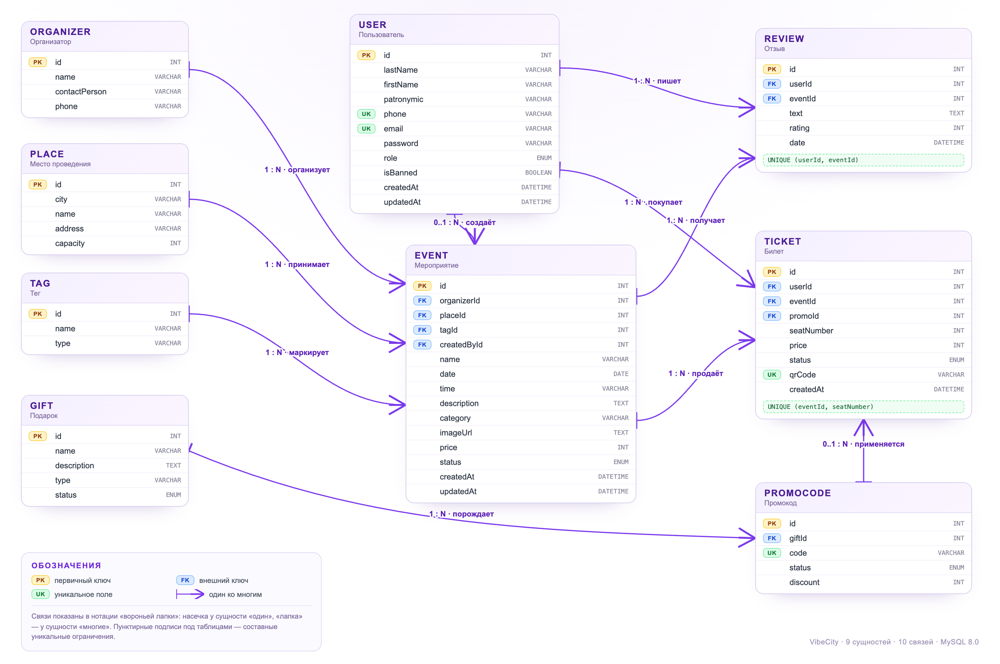

# Проектирование базы данных VibeCity

База данных афиши мероприятий: **9 сущностей**, **10 связей**, MySQL 8.0, доступ через Prisma ORM.
Схема описана в [`backend/prisma/schema.prisma`](../../backend/prisma/schema.prisma).



Отдельные файлы:

- [`er-diagram.png`](er-diagram.png) — готовая картинка для вставки в отчёт или презентацию;
- [`er-diagram.html`](er-diagram.html) — исходник диаграммы, открывается в браузере и масштабируется без потери качества;
- [`database-design.pdf`](database-design.pdf) — версия для печати;
- [`demo-script.md`](demo-script.md) — что и в каком порядке показывать преподавателю.

---

## 1. Логика схемы

Схему удобно объяснять тремя группами:

| Группа | Сущности | Роль |
| --- | --- | --- |
| **Справочники** | `Organizer`, `Place`, `Tag` | Данные, которые переиспользуются в мероприятиях |
| **Основной домен** | `Event`, `User`, `Ticket`, `Review` | Афиша, аккаунты, продажи билетов и обратная связь |
| **Маркетинг** | `Gift`, `Promocode` | Подарки и скидки, привязанные к покупке |

Центральная сущность — **`Event`**. Она ссылается на три справочника, а от неё зависят билеты и
отзывы. Пользователь связан с мероприятием через билеты и отзывы, а также как автор карточки
события (`createdById`).

---

## 2. Сущности и ключевые атрибуты

| # | Сущность | Назначение | PK | Ключевые поля и связи |
| --- | --- | --- | --- | --- |
| 1 | `User` | Аккаунты пользователей и администраторов | `id` | `email` UK, `phone` UK, `password` (bcrypt), `role`, `isBanned`; 1:N `Review`, `Ticket`, `Event` (как автор) |
| 2 | `Organizer` | Справочник организаторов | `id` | `name`, `contactPerson`, `phone`; 1:N `Event` |
| 3 | `Place` | Площадки проведения | `id` | `city`, `name`, `address`, `capacity`; 1:N `Event` |
| 4 | `Tag` | Теги для навигации | `id` | `name`, `type`; 1:N `Event` |
| 5 | `Event` | Мероприятие — центральная сущность | `id` | FK `organizerId`, `placeId`, `tagId`, `createdById`; `date`, `time`, `price`, `status`, `imageUrl`; 1:N `Ticket`, `Review` |
| 6 | `Review` | Отзыв зрителя | `id` | FK `userId`, `eventId`; `rating` 1–5, `text`; UNIQUE(`userId`, `eventId`) |
| 7 | `Gift` | Подарок / бонус | `id` | `name`, `description`, `type`, `status`; 1:N `Promocode` |
| 8 | `Promocode` | Одноразовый промокод | `id` | FK `giftId`; `code` UK, `status`, `discount` (%); 1:N `Ticket` |
| 9 | `Ticket` | Купленный билет | `id` | FK `userId`, `eventId`, `promoId`; `seatNumber`, `price`, `status`, `qrCode` UK; UNIQUE(`eventId`, `seatNumber`) |

---

## 3. Связи и правила целостности

| Связь | Кардинальность | Внешний ключ | ON DELETE |
| --- | --- | --- | --- |
| `Organizer` → `Event` | 1 : N | `Event.organizerId` | `RESTRICT` |
| `Place` → `Event` | 1 : N | `Event.placeId` | `RESTRICT` |
| `Tag` → `Event` | 1 : N | `Event.tagId` | `RESTRICT` |
| `User` → `Event` (автор карточки) | 0..1 : N | `Event.createdById` | `SET NULL` |
| `User` → `Review` | 1 : N | `Review.userId` | `CASCADE` |
| `Event` → `Review` | 1 : N | `Review.eventId` | `CASCADE` |
| `User` → `Ticket` | 1 : N | `Ticket.userId` | `CASCADE` |
| `Event` → `Ticket` | 1 : N | `Ticket.eventId` | `CASCADE` |
| `Promocode` → `Ticket` | 0..1 : N | `Ticket.promoId` | `SET NULL` |
| `Gift` → `Promocode` | 1 : N | `Promocode.giftId` | `CASCADE` |

Почему так:

- **`RESTRICT`** для справочников не даёт удалить площадку или организатора, пока на них ссылаются
  мероприятия. Преподавателю это легко показать: попытка удалить место с событиями возвращает
  понятную ошибку `409`.
- **`CASCADE`** для отзывов и билетов: при удалении мероприятия его билеты и отзывы не должны
  оставаться «сиротами».
- **`SET NULL`** для автора карточки и промокода: удаление пользователя или промокода не должно
  уничтожать сам билет или мероприятие.

---

## 4. Ключи, уникальность и индексы

**Первичные ключи:** во всех таблицах — автоинкрементный `id` (`INT`).

**Уникальные поля:**

- `User.email`, `User.phone` — один аккаунт на email и телефон;
- `Promocode.code` — код промокода не повторяется;
- `Ticket.qrCode` — UUID для QR-кода уникален.

**Составные уникальные ограничения:**

- `Review @@unique([userId, eventId])` — один пользователь оставляет один отзыв на мероприятие;
- `Ticket @@unique([eventId, seatNumber])` — на одно место не может быть продано два билета
  (защита от гонки при одновременной покупке).

**Индексы:**

- `Event @@index([date])` — сортировка и фильтрация по датам;
- `Event @@index([category])` — фильтр по категории;
- `Event @@index([status])` — публичная афиша и модерация;
- `Review @@index([eventId])` — отзывы конкретного события;
- `Ticket @@index([userId])` — билеты пользователя.

---

## 5. Перечисления (ENUM)

| Поле | Значения | Зачем |
| --- | --- | --- |
| `User.role` | `USER`, `ADMIN` | Разграничение доступа к админке |
| `Event.status` | `PENDING`, `APPROVED`, `REJECTED` | Модерация мероприятий |
| `Ticket.status` | `ACTIVE`, `USED`, `CANCELLED` | Жизненный цикл билета |
| `Promocode.status` | `ACTIVE`, `USED`, `EXPIRED` | Одноразовость и срок действия |
| `Gift.status` | `AVAILABLE`, `RESERVED`, `GIVEN` | Статус подарка |

ENUM выбран вместо отдельной таблицы-справочника, потому что набор значений фиксирован ТЗ и
используется в бизнес-логике.

---

## 6. Нормализация

Схема приведена к **третьей нормальной форме (3НФ)**.

**1НФ** — все атрибуты атомарны: нет массивов, вложенных JSON и повторяющихся групп. Время
хранится отдельным полем `time`, дата — `date`.

**2НФ** — используются суррогатные первичные ключи; неключевые атрибуты зависят от всего ключа,
частичных зависимостей нет.

**3НФ** — устранены транзитивные зависимости:

- город и адрес хранятся в `Place`, а не дублируются в каждой строке `Event`;
- контактное лицо организатора хранится в `Organizer`;
- данные подарка хранятся в `Gift`, а не в `Promocode`;
- автор отзыва хранится в `User`, а не текстом;
- рейтинг мероприятия **не хранится** в `Event`, а вычисляется агрегатом `AVG(Review.rating)`;
- количество свободных мест **не хранится**, а считается как `Place.capacity - COUNT(Ticket)`.

**Осознанные исключения из строгой нормализации:**

- `Ticket.price` — исторический снимок цены на момент покупки. Если организатор позже изменит
  `Event.price`, уже купленный билет не должен подорожать;
- `Event.status` — состояние бизнес-процесса модерации, а не дублирование данных;
- `Event.category` — строковая категория для фильтра; при необходимости её можно вынести в
  отдельный справочник, но по ТЗ категория — атрибут мероприятия.

---

## 7. Обоснование решений (что говорить на защите)

| Решение | Обоснование |
| --- | --- |
| `Event.price` + `Ticket.price` | Цена события — текущая, цена билета — зафиксированная на момент покупки |
| `Promocode.discount` | Скидка в процентах, итоговая цена считается на сервере в транзакции |
| `Ticket.qrCode` = UUID | Уникальный идентификатор для проверки на входе; не угадывается |
| `UNIQUE(eventId, seatNumber)` | Два человека не купят одно место даже при одновременных запросах |
| `Event.status` | Пользовательские мероприятия уходят на модерацию, публикуются только `APPROVED` |
| `Event.createdById` | Позволяет показать «мои мероприятия» и ограничить редактирование автором |
| `User.isBanned` | Блокировка без удаления истории билетов и отзывов |
| `ON DELETE RESTRICT` | Нельзя удалить справочник, на который есть ссылки |
| `ON DELETE CASCADE` | Удаление события убирает его билеты и отзывы, не оставляя мусор |
| Транзакция при покупке | Одновременно создаётся билет и помечается использованным промокод |

---

## 8. Проверка схемы вживую

Команды выполняются внутри Docker-контейнера `vibecity`:

```bash
# список таблиц
docker exec -it vibecity mysql --default-character-set=utf8mb4 -uvibecity -pvibecity vibecity -e "SHOW TABLES;"

# структура таблицы и внешние ключи
docker exec -it vibecity mysql --default-character-set=utf8mb4 -uvibecity -pvibecity vibecity -e "SHOW CREATE TABLE Ticket\G"

# все внешние ключи базы
docker exec -it vibecity mysql --default-character-set=utf8mb4 -uvibecity -pvibecity vibecity -e "
SELECT TABLE_NAME, COLUMN_NAME, REFERENCED_TABLE_NAME, REFERENCED_COLUMN_NAME
FROM information_schema.KEY_COLUMN_USAGE
WHERE TABLE_SCHEMA = 'vibecity' AND REFERENCED_TABLE_NAME IS NOT NULL;"

# индексы мероприятия
docker exec -it vibecity mysql --default-character-set=utf8mb4 -uvibecity -pvibecity vibecity -e "SHOW INDEX FROM Event;"
```

### Пример JOIN: мероприятие + площадка + организатор + тег

```sql
SELECT e.id, e.name, e.date, e.time,
       p.city, p.name AS place,
       o.name AS organizer,
       t.name AS tag
FROM Event e
JOIN Place p     ON p.id = e.placeId
JOIN Organizer o ON o.id = e.organizerId
JOIN Tag t       ON t.id = e.tagId
ORDER BY e.date
LIMIT 5;
```

### Пример: билеты пользователя с QR-кодом

```sql
SELECT t.id, e.name, t.seatNumber, t.price, t.qrCode, u.email
FROM Ticket t
JOIN Event e ON e.id = t.eventId
JOIN User u  ON u.id = t.userId
ORDER BY t.id DESC
LIMIT 5;
```

### Пример: свободные места

```sql
SELECT p.capacity - COUNT(t.id) AS available
FROM Event e
JOIN Place p ON p.id = e.placeId
LEFT JOIN Ticket t ON t.eventId = e.id AND t.status = 'ACTIVE'
WHERE e.id = 1
GROUP BY p.capacity;
```

### Пример: рейтинг мероприятия

```sql
SELECT e.name, ROUND(AVG(r.rating), 1) AS rating, COUNT(r.id) AS reviews
FROM Event e
LEFT JOIN Review r ON r.eventId = e.id
GROUP BY e.id, e.name
ORDER BY rating DESC;
```

### Проверка использования индекса

```sql
EXPLAIN SELECT *
FROM Event
WHERE status = 'APPROVED' AND category = 'Концерты'
ORDER BY date;
```

---

## 9. Как это показать преподавателю

Короткий сценарий — в [`demo-script.md`](demo-script.md). Основная последовательность:

1. Открыть ER-диаграмму и назвать три группы сущностей.
2. Открыть `schema.prisma` и показать, что схема — единый источник истины.
3. Выполнить `SHOW TABLES`, `SHOW CREATE TABLE Ticket`, запрос внешних ключей.
4. Сделать JOIN-запрос и показать данные, которые только что появились из интерфейса.
5. Купить билет в приложении и показать новую строку в `Ticket`.
6. Показать ограничения: уникальность места, `RESTRICT` при удалении площадки, каскады.
7. Объяснить 3НФ и осознанные исключения (`Ticket.price`, вычисляемый рейтинг).
